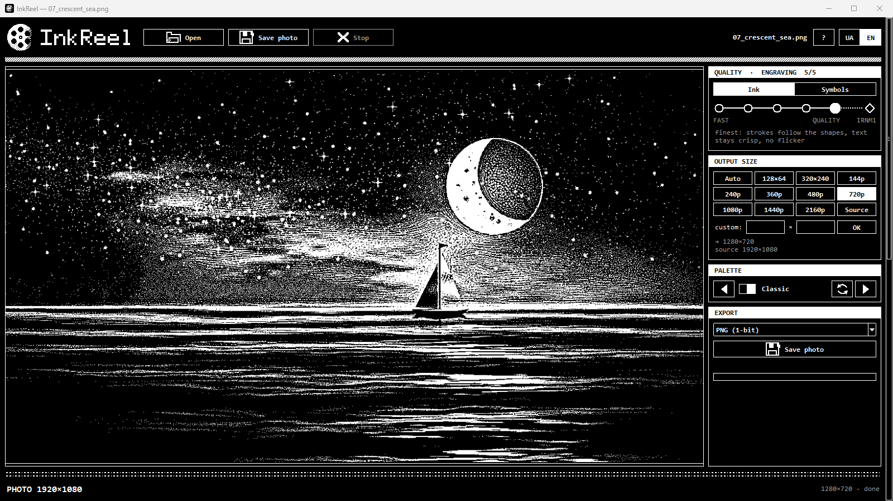
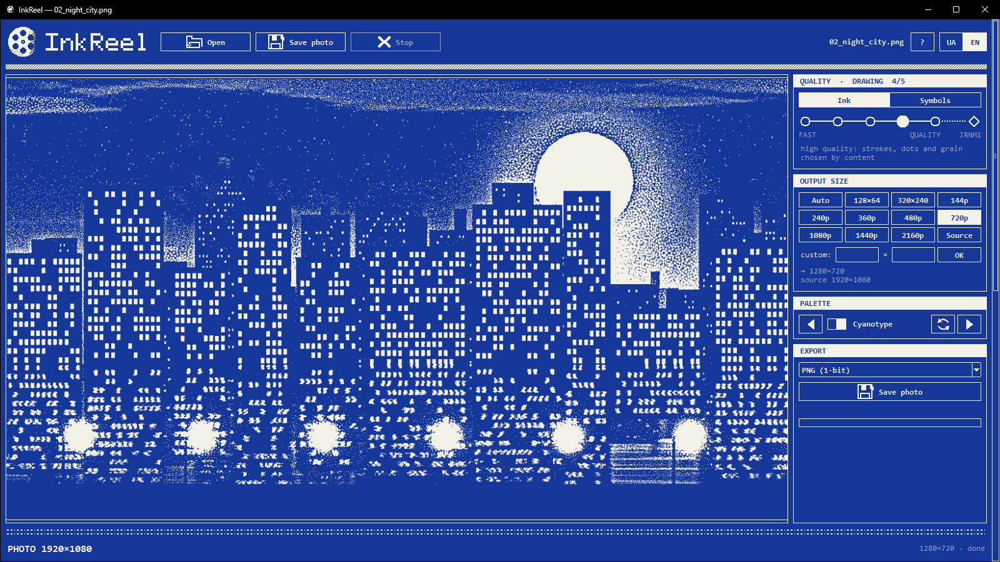
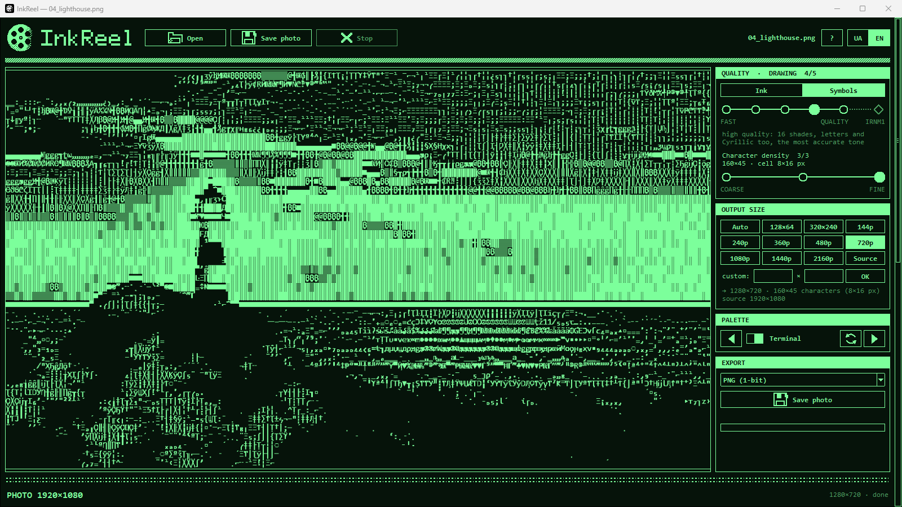

# InkReel

[](https://github.com/Chimmurai/inkreel/actions/workflows/tests.yml)

*The world is made of two colors.*

InkReel is a free Windows 10/11 (64-bit) app that turns video, photos and GIFs into pure black and white: every pixel is either ink or paper, with dots, strokes and grain chosen by what is in the frame.

**Website:** https://inkreel.raimex.space  
**Microsoft Store:** https://apps.microsoft.com/detail/9NW62SPG91ZR  
**Download:** [latest release](https://github.com/Chimmurai/inkreel/releases/latest) (`InkReel-Setup.exe`)

> **Official sources.** InkReel is made by Raimex and is published in exactly three places: this repository, the [Microsoft Store](https://apps.microsoft.com/detail/9NW62SPG91ZR) and the [website](https://inkreel.raimex.space). The release page lists the SHA-256 of every installer. Copies from anywhere else are not ours.



| Drawing level | Symbols mode |
|---|---|
|  |  |

## Install

- **Microsoft Store:** https://apps.microsoft.com/detail/9NW62SPG91ZR (updates arrive on their own)
- **Installer:** `InkReel-Setup.exe` from the [latest release](https://github.com/Chimmurai/inkreel/releases/latest). It is not code-signed yet, so Windows SmartScreen may warn about an unknown publisher ("More info" > "Run anyway"). Compare the SHA-256 on the release page with your download if you like.

Requirements: Windows 10 or newer, 64-bit, 4 GB of memory (8 or more recommended). A graphics card is optional; it only speeds up IRNM1.

## What it does

- **Five levels, from a quick sketch to a detailed engraving:** Sketch, Outline, Halftone, Drawing, Engraving. Each area of the frame gets its own hand, and clean flat surfaces stay clean.
- **IRNM1:** our own neural network, a separate branch beside the algorithm, several times faster. It runs through ONNX Runtime (DirectML on a graphics card, otherwise CPU) and falls back to Engraving if it cannot run.
- **Symbols mode:** a picture made of real glyphs of a monospaced font, chosen by tone. All five levels work here too.
- **Viewing:** zoom in whole-pixel steps up to 6400%, so every pixel stays a crisp square.
- **Render all (`.ikr`):** compute once, then play, zoom and export without recomputing.
- **Export:** MP4 with sound, GIF and more, a frame-rate cap, 20 palettes. The same frame always gives the same result.
- **Interface:** Ukrainian and English; the installer language becomes the app language.

Everything runs locally on your computer. See the [privacy policy](https://inkreel.raimex.space/en/privacy/).

## Run from source

```
InkReel.bat          menu: 2 creates the environments, 1 runs the app
python -m benvid     the window
python -m benvid in.mp4 out.mp4 --size 720p
scripts\tests.bat    the test suite
```

Dependencies are in `requirements.txt`.

## Build

```
scripts\build_exe.bat    PyInstaller build and, if Inno Setup is installed, InkReel-Setup.exe
scripts\build_msix.bat   Microsoft Store package
```

## Repository

| Path | What is there |
|------|---------------|
| `benvid/` | the app (`core`, `player`, `video`, `qtui/` (the window), `student/` for IRNM1) |
| `weights/` | model weights; the app ships the exported ONNX models |
| `tests/` | tests |
| `tools/` | dataset, training and generator scripts |
| `store/`, `installer/` | Microsoft Store package and Inno Setup installer |
| `CHANGELOG.md` | release notes |
| `THIRD_PARTY_NOTICES.md`, `licenses/` | licenses of bundled components |

## License

InkReel's own code and model weights are released under the [Apache License 2.0](LICENSE). Bundled third-party components, including FFmpeg (GPL), keep their own licenses: see [THIRD_PARTY_NOTICES.md](THIRD_PARTY_NOTICES.md).

Made by Raimex.
